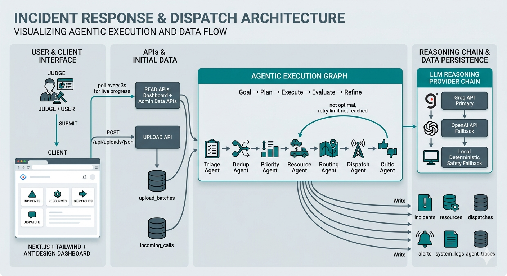
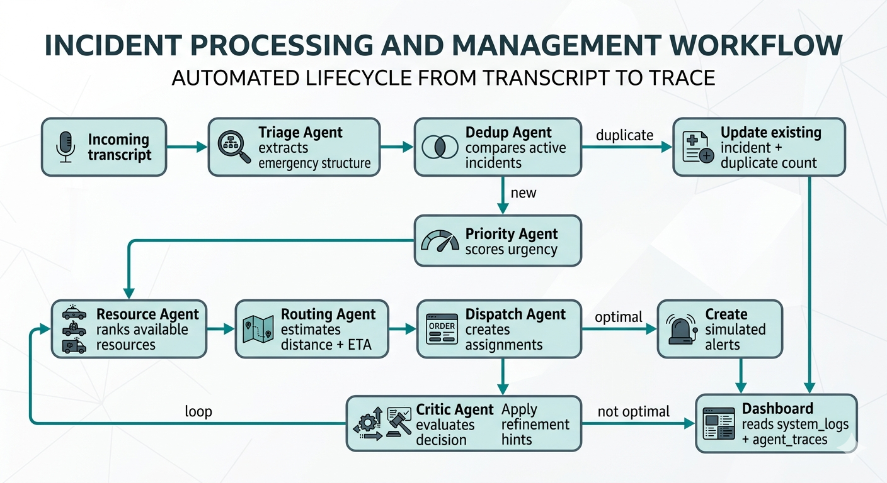
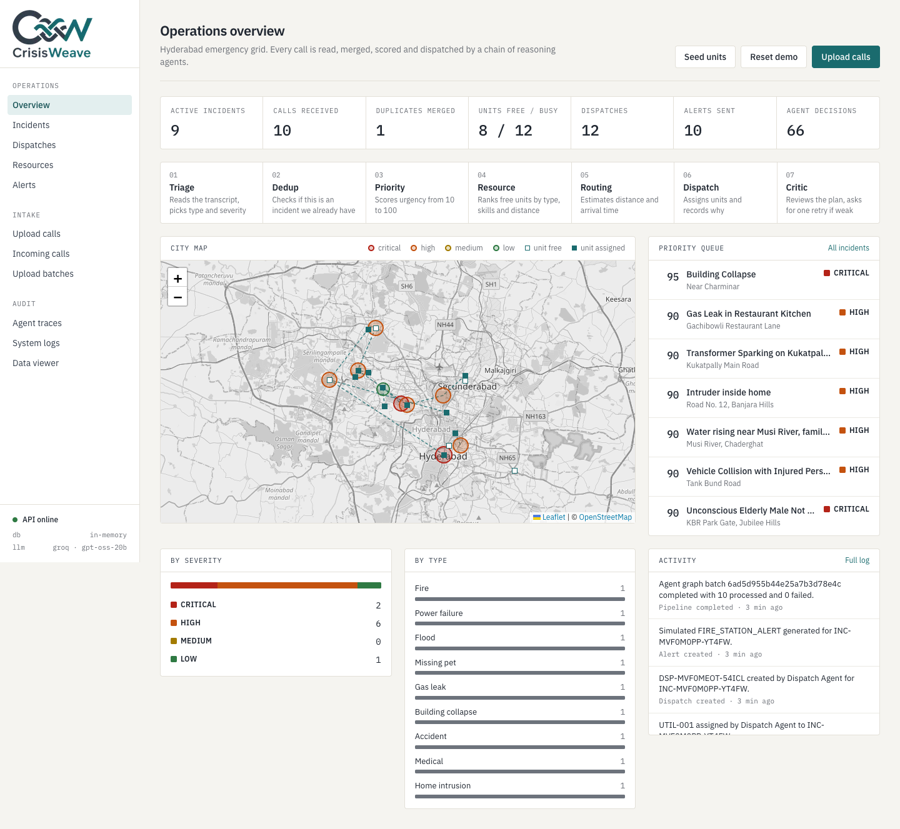

# CrisisWeave - Smart City Dynamic Dispatch Grid

CrisisWeave is an AI hackathon prototype that turns uploaded emergency transcript JSON bundles into deduplicated incidents, priority scores, dispatch decisions, simulated alerts, and explainable agent traces.

This is not a real phone-call or alert-delivery system. Emergency inputs are uploaded JSON records, and alerts are simulated database records for dashboard visibility.

## What Makes It Agentic

The backend is built around an agentic execution graph:

```text
Goal
→ Plan
→ Triage Agent
→ Dedup Agent
→ Priority Agent
→ Resource Agent
→ Routing Agent
→ Dispatch Agent
→ Critic Agent
→ Refine resource/dispatch if needed
→ Persist trace memory
```

Each agent records:

- what it received
- what it decided
- why it decided it
- which reasoning provider was used
- optional critique and refinement suggestions

Reasoning is powered by API keys:

1. Groq API is primary.
2. OpenAI API is fallback.
3. Existing deterministic logic is final resilience fallback only.

## Project Structure

```text
server/   Node.js + Express + TypeScript + MongoDB/Mongoose API
client/   Next.js + Tailwind dashboard
data/     Hyderabad sample JSON emergency transcript bundle
assets/   README images and project visual assets
docs/     Architecture diagram and full project report
```

Detailed docs:

- [System architecture](docs/SYSTEM_ARCHITECTURE.md)
- [Project report](docs/PROJECT_REPORT.md)

## High-Level Architecture



## Decision Flow



## The Dashboard



| Page | What it shows |
| --- | --- |
| Overview | Live counts, the 7-agent chain, a Hyderabad map (incidents by severity, units, dispatch lines), the priority queue and an activity feed |
| Upload calls | Drop/paste a JSON bundle or load the bundled sample, then watch progress and agent decisions arrive live |
| Incidents / detail | Merged incidents; the detail page shows every call, each agent step with its reasoning, the units sent and the alerts raised |
| Dispatches, Resources, Alerts | What was sent where, the fleet's status, and the simulated agency alerts |
| Agent traces | Every agent run grouped per call, tagged `groq` or `rules` so you can see which brain made each decision |
| Incoming calls, Upload batches, System logs, Data viewer | Raw intake data, the event log and the raw MongoDB documents |

The frontend is plain Next.js + Tailwind with Leaflet for the map: no component library, one polling hook (`lib/usePolling.ts`) shared by every page.

## Resilience

- **LLM:** every agent calls Groq first (`openai/gpt-oss-20b`), waits and retries once on a rate limit, then tries OpenAI, then falls back to deterministic rules. The provider used is stored on each trace.
- **Database:** if `MONGODB_URI` is missing or unreachable, the server starts an in-memory MongoDB instead of crashing, and seeds the Hyderabad fleet automatically. Data in that mode is lost on restart.

## Environment Setup

Backend env:

```bash
MONGODB_URI=mongodb+srv://<username>:<password>@<cluster-url>/?retryWrites=true&w=majority
MONGODB_DB_NAME=crisisweave_db
PORT=4000
DEDUP_RADIUS_KM=1
DEDUP_WINDOW_MINUTES=60
GROQ_API_KEY=<your-groq-api-key>
GROQ_MODEL=openai/gpt-oss-20b
OPENAI_API_KEY=<your-openai-api-key>
OPENAI_MODEL=gpt-4o-mini
```

Frontend env:

```bash
BACKEND_API_URL=http://localhost:4000
# Optional direct-browser API mode:
# NEXT_PUBLIC_API_BASE_URL=http://localhost:4000/api
```

`BACKEND_API_URL` is read when the frontend is **built**, so redeploy the frontend after changing it. Leave `NEXT_PUBLIC_API_BASE_URL` unset unless it points at a live backend; if it is set, the browser calls that URL directly and skips the proxy.

On Render, set `BACKEND_API_URL` on the frontend service to your deployed Express backend URL, for example `https://crisisweave-backend.onrender.com`. The frontend calls `/api/...`, and Next proxies those requests to `${BACKEND_API_URL}/api/...`.

Do not commit real API keys, passwords, or production connection strings.

## Run Backend

```bash
cd server
npm install
npm run dev
```

The server seeds the Hyderabad units on its own when the database is empty (`npm run seed` still works).

## Run Frontend

```bash
cd client
npm install
npm run dev
```

Open `http://localhost:3000`.

## Demo Flow For Judges

1. Start backend and frontend.
2. Go to Upload calls and click "Load the Hyderabad sample", then Start processing.
3. Watch the agent decisions stream in (about 15–20 s per call on the free Groq tier).
4. Open the Overview map to see incidents, units and dispatch lines.
5. Check the Overview for totals, incidents, resources, dispatches, alerts, and trace counts.
6. Open Agent Traces to show step-by-step AI reasoning.
7. Open an Incident Detail page to show linked transcripts, dispatch decisions, alerts, and agent trace memory.

The sample includes fire duplicate reports, medical emergency, accident, flood, building collapse, home intrusion, missing pet, power failure, and gas leak.

## Pipeline

```text
JSON upload
→ upload_batches
→ incoming_calls
→ agentic execution graph
→ LLM-first triage/dedup/priority/resource/routing/dispatch/critic
→ incident create/update
→ dispatches
→ simulated alerts
→ system_logs
→ agent_traces
→ dashboard APIs
```

## API List

- `POST /api/uploads/json`
- `GET /api/dashboard/summary`
- `GET /api/incoming-calls`
- `GET /api/incidents`
- `GET /api/incidents/:id`
- `GET /api/resources`
- `GET /api/dispatches`
- `GET /api/alerts`
- `GET /api/agent-traces`
- `GET /api/system-logs`
- `GET /api/upload-batches`
- `POST /api/admin/seed`
- `POST /api/admin/reset-demo-data`

List endpoints support `page`, `limit`, `status`, `severity`, `incidentType`, `resourceType`, `batchId`, `incidentId`, `incomingCallId`, `graphRunId`, and `agentName`.

## Collections

- `upload_batches`: uploaded JSON bundle metadata
- `incoming_calls`: raw transcript records, including duplicates
- `incidents`: deduplicated emergency incidents
- `resources`: available/busy Hyderabad response units
- `dispatches`: dispatch decisions and ETA outputs
- `alerts`: simulated alert records
- `agent_traces`: every agent input, output, reasoning, decision, provider, critique, and retry attempt
- `system_logs`: explainable pipeline audit trail
- `users`: basic admin/staff seed users for future auth

## Notes

- The prototype is designed to use Groq/OpenAI API keys for agent reasoning.
- Local deterministic logic is retained only to keep the demo stable if providers fail.
- The dashboard uses polling for live progress and live ETA display; WebSockets are not required for this prototype.
- No real SMS/email/phone alerts are sent.
- Authentication is intentionally not implemented yet, per current scope.
- MongoDB geospatial fields use GeoJSON points with `2dsphere` indexes.
